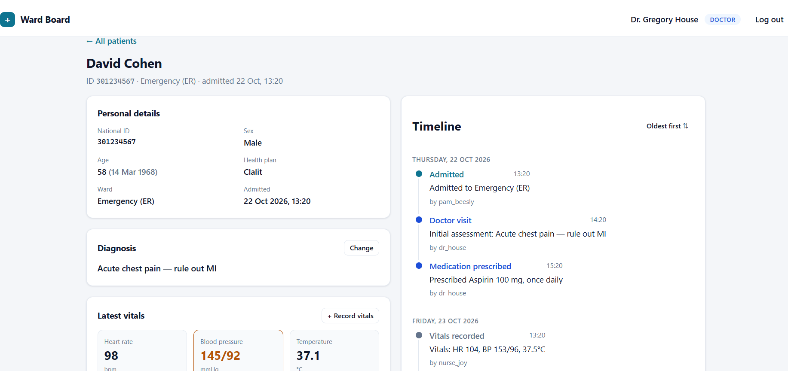
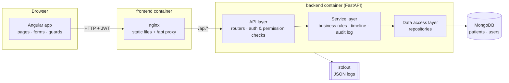
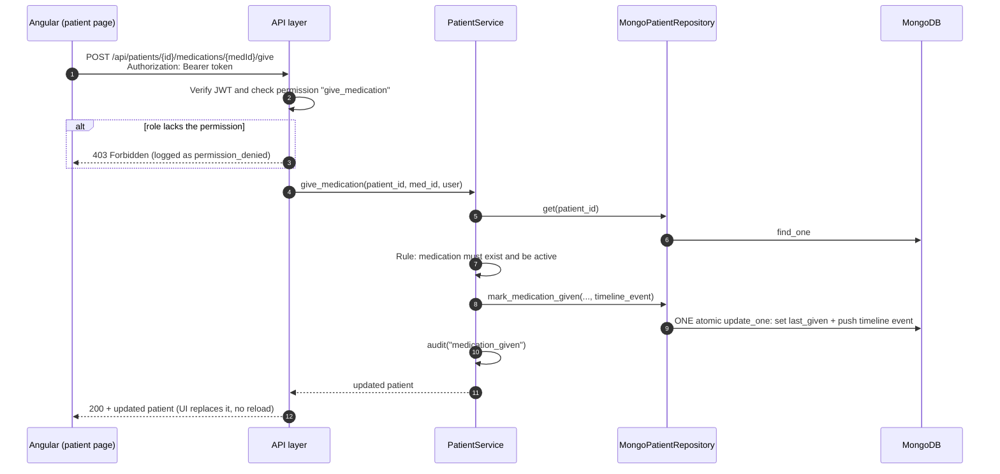

# Ward Board: Hospital Management System

An internal hospital management system. Staff can view patients by ward, follow each patient's
vitals, medications and timeline, and act on that data according to their role.

- **Backend:** Python 3.12 · FastAPI · MongoDB (PyMongo async driver) · JWT auth · structured JSON logging
- **Frontend:** Angular 20 (standalone components, signals, zoneless) served by nginx
- **Setup:** one `docker compose up`, seeded with demo wards, patients and users

## Contents

1. [Quick start](#quick-start)
2. [Architecture](#architecture)
3. [Why MongoDB](#why-mongodb)
4. [Roles and permissions](#roles-and-permissions)
5. [Handling the slow endpoint](#handling-the-slow-endpoint)
6. [Logging](#logging)
7. [API usage](#api-usage)
8. [Example usage](#example-usage)
9. [Tests](#tests)
10. [Project structure](#project-structure)
11. [Configuration](#configuration)
12. [Assumptions and trade-offs](#assumptions-and-trade-offs)

## Screenshots

| Main page: patients grouped by ward | Patient page |
|---|---|
|  |  |
| **Slow endpoint: loading state** | **Login** |
|  |  |

## Quick start

**Requirements:** Docker Desktop (or Docker Engine with Compose v2).

```bash
git clone <repository-url>
cd hospital-management-system
docker compose up --build
```

The first build takes a few minutes. Then open:

| What | URL |
|---|---|
| Web app | http://localhost:8080 |
| API (Swagger, interactive docs) | http://localhost:8000/docs |
| Health check | http://localhost:8000/api/health |

**Demo users** (password for all: `password123`). The login page also has one-click buttons for them.

| Username | Role |
|---|---|
| `dr_house` | Doctor |
| `nurse_joy` | Nurse |
| `pam_beesly` | Secretary |

On first start the database is seeded with 3 users and 14 patients in 4 wards (ER, Internal
Medicine A, ICU, Pediatrics). Each patient has a diagnosis, at least one active medication, two
sets of vitals, and 7+ timeline events spread over 3 days.

To reset the data:

```bash
docker compose down -v      # -v also deletes the database volume
docker compose up --build
```

### Running without Docker (development)

```bash
# 1. MongoDB only
docker compose up -d mongo

# 2. Backend (http://localhost:8000)
cd backend
python -m venv .venv
.venv\Scripts\activate          # Windows  (macOS/Linux: source .venv/bin/activate)
pip install -r requirements.txt
cp .env.example .env
uvicorn app.main:app --reload

# 3. Frontend (http://localhost:4200, proxies /api to :8000)
cd frontend
npm install
npm start
```

## Architecture

### System overview



### Request flow: a nurse marks a medication as given



### Layers

The backend is split into layers. Each layer only talks to the one below it.

| Layer | Folder | Responsibility | Does not know about |
|---|---|---|---|
| **API / routing** | `backend/app/api/` | HTTP routes, request validation, auth and permission checks, mapping errors to status codes | MongoDB, business rules |
| **Service / business logic** | `backend/app/services/` | Business rules (e.g. only an active medication can be given), building timeline events, audit logging | HTTP, MongoDB |
| **Data access** | `backend/app/repositories/` | Reading and writing MongoDB documents | Business rules, HTTP |
| Domain | `backend/app/domain/` | Entities, validation rules, enums, the permission table, domain errors | Everything above |
| Core | `backend/app/core/` | Config, DB connection, password hashing and JWT, logging setup | |

- Services depend on **repository interfaces** (`repositories/base.py`), not on MongoDB.
  The concrete classes are chosen in one place, `api/dependencies.py`.
- Services raise **domain errors** (`NotFoundError`, `PermissionDeniedError`, ...).
  `api/error_handlers.py` maps them to 404 / 403 / 409, so services never deal with HTTP.

### SOLID, where it fits

- **Single responsibility:** each class has one job. `MongoDatabase` handles the connection
  only, `AuthService` handles login only, `audit()` handles audit records only. On the frontend,
  `PatientApiService` only does HTTP, `PatientListStore` only holds list state, and the form
  components only collect input.
- **Open/closed:** endpoints check *permissions*, never roles
  (`require_permission(Permission.PRESCRIBE_MEDICATION)`). Adding a role or changing what a role
  may do is a one-line change in `domain/permissions.py`, with no endpoint changes.
- **Liskov substitution:** `MongoPatientRepository` and the in-memory `InMemoryPatientRepository`
  used in tests honour the same contract and can replace each other.
- **Interface segregation:** `AuthService` depends only on `UserRepository`. It does not see
  patient operations.
- **Dependency inversion:** `PatientService(patients: PatientRepository)` receives an
  abstraction. This is what lets the whole business layer be unit-tested without a database.

### Frontend structure

| Part | Files | Purpose |
|---|---|---|
| Auth | `core/auth.service.ts`, `auth.interceptor.ts`, `auth.guards.ts` | Keeps the JWT session, adds the token to every API call, logs out on 401, protects routes by login and by permission |
| Permission-aware UI | `core/has-permission.directive.ts` | `*appHasPermission="'prescribe_medication'"` hides actions the role can't do. This is for convenience only: the backend enforces every permission. |
| API client | `core/patient-api.service.ts` | Typed wrapper around `/api/patients` |
| Slow list handling | `core/patient-list.store.ts` | See [Handling the slow endpoint](#handling-the-slow-endpoint) |
| Pages | `pages/login`, `pages/patient-list`, `pages/patient-detail`, `pages/patient-form` | Lazy-loaded routes |
| Presentational components | `pages/patient-detail/*.component.ts` | Timeline and the vitals / medication / diagnosis forms. They emit values and never call the API, so the page owns all server communication. |

Routes: `/login`, `/patients`, `/patients/new` (secretary), `/patients/:id`,
`/patients/:id/edit` (secretary).

## Why MongoDB

**A patient is naturally one document.** Personal details, diagnosis, medications, vitals and the
timeline all belong to a single patient and are almost always read together. Storing them as one
document (with embedded arrays) means:

- **The patient page is a single read.** There are no joins across five tables.
- **Clinical actions are atomic without transactions.** In MongoDB a write to a single document is
  atomic. Marking a medication as given updates the medication *and* appends the timeline event
  in one `update_one`, so the system can never end up with "dose given, but no timeline entry".
  The same filter also re-checks that the medication is still active, which closes a race window.
- **The schema can evolve.** Timeline events carry different details per type (a vitals event vs.
  a diagnosis change), and new vital signs (SpO₂, glucose) could be added without migrations.
  Validation lives in the application layer (Pydantic models), so data stays consistent.
- **The overview query maps to an aggregation pipeline.** "Group patients by ward, with last vitals
  time and active medication count" is a single `$project` → `$group` pipeline, computed in the
  database rather than in Python.
- **It is easy to run.** The official image works with a single line in `docker-compose.yml`.

**Alternatives considered**

- **MySQL** would also work. However, every patient read would need joins across
  patients / medications / vitals / events tables, and each clinical action would need an explicit
  transaction to stay consistent.
- **Elasticsearch** is built for full-text search and analytics. Free-text search is not a
  requirement here, and it is a weaker primary store for transactional updates.

**Known trade-off:** embedded arrays (vitals, timeline) grow over a long admission. MongoDB's
16 MB document limit is far away for this scope. In production, high-volume data such as vitals
and events would move to their own collections, bucketed by patient and time.

## Roles and permissions

Permissions are defined once, in `backend/app/domain/permissions.py`, and enforced on every
endpoint.

| Action | Permission | Doctor | Nurse | Secretary |
|---|---|:-:|:-:|:-:|
| View patients | `read_patients` | ✅ | ✅ | ✅ |
| Prescribe medication | `prescribe_medication` | ✅ | | |
| Mark medication as given | `give_medication` | ✅ | ✅ | |
| Record vitals | `record_vitals` | ✅ | ✅ | |
| Change diagnosis | `change_diagnosis` | ✅ | | |
| Add patient | `create_patient` | | | ✅ |
| Update patient details | `update_patient_info` | | | ✅ |
| Delete patient | `delete_patient` | | | ✅ |

A request without a valid token gets **401**. A valid token without the permission gets **403**,
which is also written to the audit log.

## Handling the slow endpoint

**The delay (backend).** `GET /api/patients`, the endpoint behind the main page, waits
`PATIENT_LIST_DELAY_SECONDS` (default **4s**) before answering. See `list_patients` in
`backend/app/api/routers/patients.py`. It uses `await asyncio.sleep(...)`, so the server keeps
serving other requests during the delay. The single-patient endpoint stays fast.

**The handling (frontend).** The list state lives in `PatientListStore`
(`frontend/src/app/core/patient-list.store.ts`), a singleton service, not in the page component.

| # | Mechanism | What the user experiences |
|---|---|---|
| 1 | **Stale-while-revalidate cache** | On returning to the list, the last result is shown instantly while a fresh copy loads in the background. |
| 2 | **Progress feedback** | First load shows skeleton placeholders shaped like the real tables. Every load shows a progress bar. After 2s a "still loading (Ns)" notice appears, so the app never looks frozen. |
| 3 | **Timeout** | After 15s the request is abandoned and a clear error with a **Retry** button is shown. |
| 4 | **Automatic retry** | Network errors and 5xx responses are retried once after 1s. 4xx errors are not retried, because a retry won't help. |
| 5 | **De-duplication** | A load already in flight is reused, so double-clicking Refresh never sends two slow requests. |
| 6 | **Isolation** | The patient page uses its own fast endpoint and cancels its request when the user navigates away (`switchMap` + `takeUntilDestroyed`), so it never waits for the list. |

Two related details:
- **Search is client-side**, over the already-loaded list. It is instant and never triggers
  another slow request.
- **Delete updates the cache locally**, so a deleted patient disappears immediately.

## Logging

All logging uses Python's `logging` module. Every line is **one JSON object** on stdout, ready for
ELK / Loki / CloudWatch (`backend/app/core/logging_config.py`).

- **Request correlation:** a middleware assigns each request an `X-Request-ID` (or reuses the
  caller's), adds it to every log line of that request, logs method / path / status / duration,
  and returns the ID in the response header. The frontend shows the first characters of the ID in
  error messages (`ref: ...`), so a user report can be matched to the server logs.
- **Audit trail:** critical actions go through a single function, `audit()`
  (`backend/app/core/audit.py`). They all use the `hospital.audit` logger and the same fields:
  `event`, `outcome` (`success` / `failure` / `denied`), `actor`, `role`, `patient_id`.
  Failures and denials are logged at `WARNING`.

| Event | `event` value | Where |
|---|---|---|
| Medication prescribed | `medication_prescribed` | `services/patient_service.py` |
| Medication marked as given | `medication_given` | `services/patient_service.py` |
| Vitals recorded | `vitals_recorded` | `services/patient_service.py` |
| Login success / failure (reason: `unknown_user` / `wrong_password`) | `login` | `services/auth_service.py` |
| Permission denied | `permission_denied` | `api/dependencies.py` (`require_permission`) |
| Also: patient created / updated / deleted, diagnosis changed, invalid token | `patient_created`, ..., `token_rejected` | services |

Success events are logged in the service layer *after* the write succeeds, so the log never
claims an action that did not happen. A failed login returns the same message to the client in both
cases (to avoid revealing which usernames exist), but the log records the real reason.

Example lines:

```json
{"timestamp": "2026-10-25T10:26:37.102+00:00", "level": "INFO", "logger": "hospital.audit", "message": "medication_given: success", "request_id": "6a6649db...", "event": "medication_given", "outcome": "success", "actor": "nurse_joy", "role": "nurse", "patient_id": "301234567", "medication_id": "9f2c...", "medication": "Aspirin"}
{"timestamp": "2026-10-25T10:26:41.530+00:00", "level": "WARNING", "logger": "hospital.audit", "message": "permission_denied: denied", "request_id": "d80d69db...", "event": "permission_denied", "outcome": "denied", "actor": "nurse_joy", "role": "nurse", "permission": "prescribe_medication", "method": "POST", "path": "/api/patients/301234567/medications"}
{"timestamp": "2026-10-25T10:26:45.003+00:00", "level": "WARNING", "logger": "hospital.audit", "message": "login: failure", "request_id": "62016535...", "event": "login", "outcome": "failure", "actor": "nurse_joy", "role": "nurse", "reason": "wrong_password"}
```

To view the backend logs only:

```bash
docker compose logs -f backend
```

## API usage

Full interactive documentation (request/response schemas, try-it-out) is at
**http://localhost:8000/docs**. Click **Authorize** and paste a token from `/api/auth/login`.

| Method | Path | Permission | Description |
|---|---|---|---|
| `GET` | `/api/health` | none | Liveness and database check |
| `POST` | `/api/auth/login` | none | Username + password → JWT |
| `GET` | `/api/auth/me` | logged in | Current user and their permissions |
| `GET` | `/api/patients` | `read_patients` | All patients grouped by ward. **Deliberately slow.** |
| `GET` | `/api/patients/{id}` | `read_patients` | Full patient: info, vitals, medications, timeline |
| `POST` | `/api/patients` | `create_patient` | Admit a new patient (409 if the ID exists) |
| `PATCH` | `/api/patients/{id}` | `update_patient_info` | Update personal details (send only changed fields) |
| `DELETE` | `/api/patients/{id}` | `delete_patient` | Delete a patient (204) |
| `PUT` | `/api/patients/{id}/diagnosis` | `change_diagnosis` | Change the diagnosis (previous value kept in the timeline) |
| `POST` | `/api/patients/{id}/medications` | `prescribe_medication` | Prescribe a medication |
| `POST` | `/api/patients/{id}/medications/{medId}/give` | `give_medication` | Mark an active medication as given now |
| `POST` | `/api/patients/{id}/vitals` | `record_vitals` | Record heart rate, blood pressure, temperature |

Every write endpoint returns the **updated patient**, so the UI can refresh without another
request.

**Status codes:** `401` missing or invalid token · `403` role lacks the permission ·
`404` patient or medication not found · `409` duplicate ID or invalid state
(e.g. giving a stopped medication) · `422` invalid input (e.g. temperature 80°C).

### Examples (bash / Git Bash)

```bash
# Log in as the doctor and keep the token
TOKEN=$(curl -s -X POST http://localhost:8000/api/auth/login \
  -H "Content-Type: application/json" \
  -d '{"username": "dr_house", "password": "password123"}' | python -c "import sys, json; print(json.load(sys.stdin)['access_token'])")

# Patients grouped by ward (takes ~4 seconds)
curl -s http://localhost:8000/api/patients -H "Authorization: Bearer $TOKEN"

# One patient
curl -s http://localhost:8000/api/patients/301234567 -H "Authorization: Bearer $TOKEN"

# Prescribe a medication
curl -s -X POST http://localhost:8000/api/patients/301234567/medications \
  -H "Authorization: Bearer $TOKEN" -H "Content-Type: application/json" \
  -d '{"name": "Amoxicillin", "dose": "500 mg", "frequency": "every 8 hours"}'

# Record vitals
curl -s -X POST http://localhost:8000/api/patients/301234567/vitals \
  -H "Authorization: Bearer $TOKEN" -H "Content-Type: application/json" \
  -d '{"heart_rate": 88, "bp_systolic": 130, "bp_diastolic": 85, "temperature": 37.2}'

# Change the diagnosis
curl -s -X PUT http://localhost:8000/api/patients/301234567/diagnosis \
  -H "Authorization: Bearer $TOKEN" -H "Content-Type: application/json" \
  -d '{"diagnosis": "Unstable angina"}'
```

Logged in as `nurse_joy`, the prescription request above returns:

```json
HTTP 403
{"detail": "Role 'nurse' is not allowed to prescribe_medication"}
```

## Example usage

A walkthrough in the web app (http://localhost:8080):

1. **Sign in as the nurse.** The main page shows skeleton tables and a progress bar. After 2
   seconds a "still loading" counter appears, and after ~4 seconds four wards appear. Each row shows
   name, ID, age/sex, diagnosis, *time since last vitals* (highlighted if older than 8 hours) and
   the number of active medications.
2. Type `Cohen` in the search box. The list filters instantly.
3. Click **David Cohen**. The patient page opens immediately (fast endpoint).
4. **+ Record vitals** → enter 88 / 130 / 85 / 37.2 → save. The vitals card updates and a
   "Vitals recorded" event appears in the timeline. Entering 80/90 is rejected (systolic must be
   above diastolic).
5. **Mark as given** on a medication. It shows "Last given just now by nurse_joy".
   There are no Prescribe, Change diagnosis, Edit or Delete buttons for this role.
6. Go back to the list. The previous list is shown at once while it refreshes in the background.
7. **Sign in as the doctor.** Change the diagnosis (the timeline keeps the previous value) and
   prescribe a medication.
8. **Sign in as the secretary.** **+ Add patient**, then **Edit details** on that patient and
   move them to another ward (the timeline records "Moved to ..."), then **Delete**.
9. Still as the secretary, open `/patients/301234567` and try recording vitals through the API
   (Swagger). The response is 403, and a `permission_denied` line appears in
   `docker compose logs backend`.

## Tests

```bash
docker compose up -d --build
docker compose exec backend pytest -v
```

There are **21 test functions (49 cases with parametrization)**. They run against in-memory
repositories (`backend/tests/fakes.py`), so no database is needed. This works because services
depend on repository interfaces.

| File | What it covers |
|---|---|
| `test_patient_service.py` | Giving a medication updates it, appends a timeline event and writes an audit record. A stopped medication can't be given and nothing is recorded. Unknown medication → not found. The timeline stays chronological. Duplicate national ID is rejected. A diagnosis change keeps the previous value. An empty update is rejected. Grouping by ward. |
| `test_api.py` | Over HTTP: no token → 401. Nurse prescribing → 403 and audited; doctor → 201. Secretary create → 201, duplicate → 409, delete → 204, then 404. The list is grouped by ward. |
| `test_auth_service.py` | Successful login issues a token for the right role and is audited. Wrong password and unknown user are rejected and audited. A tampered token is rejected. |
| `test_permissions.py` | The role × permission matrix matches the assignment exactly (all 24 combinations). Only doctors can prescribe or change diagnosis. |
| `test_validation.py` | Impossible vitals, a malformed national ID and a future birth date are rejected. Age counts only full years. |

## Project structure

```
hospital-management-system/
├── docker-compose.yml            # mongo + backend + frontend
├── backend/
│   ├── Dockerfile
│   ├── requirements.txt
│   ├── .env.example
│   ├── app/
│   │   ├── main.py               # app factory, startup (DB, indexes, seed), routers
│   │   ├── seed.py               # demo users and patients
│   │   ├── api/                  # ── API layer
│   │   │   ├── routers/          #    auth.py, patients.py, health.py
│   │   │   ├── dependencies.py   #    wiring + require_permission()
│   │   │   ├── error_handlers.py #    domain errors → HTTP status codes
│   │   │   ├── middleware.py     #    request ID + request logging
│   │   │   └── schemas.py        #    response bodies
│   │   ├── services/             # ── Service layer (business logic)
│   │   ├── repositories/         # ── Data access layer (interfaces + MongoDB)
│   │   ├── domain/               # entities, validation, permissions, errors
│   │   └── core/                 # config, database, security, logging, audit
│   └── tests/
└── frontend/
    ├── Dockerfile                # build with Node, serve with nginx
    ├── nginx.conf                # SPA fallback + /api proxy
    ├── proxy.conf.json           # /api proxy for `npm start`
    └── src/app/
        ├── core/                 # auth, interceptor, guards, API client, list store
        ├── layout/               # top bar
        ├── pages/                # login, patient-list, patient-detail, patient-form
        └── shared/               # timeAgo pipe
```

## Configuration

Backend settings come from environment variables (set in `docker-compose.yml`; see
`backend/.env.example` for local runs).

| Variable | Default | Meaning |
|---|---|---|
| `MONGO_URI` | `mongodb://localhost:27017` | MongoDB connection string |
| `MONGO_DB` | `hospital` | Database name |
| `JWT_SECRET` | dev value | Secret for signing tokens. **Change in production.** |
| `JWT_EXPIRE_MINUTES` | `480` | Token lifetime (one shift) |
| `PATIENT_LIST_DELAY_SECONDS` | `4` | Artificial delay on `GET /api/patients` (`0` disables it) |
| `SEED_ON_STARTUP` | `true` | Insert demo data when the database is empty |
| `LOG_LEVEL` | `INFO` | Logging level |

## Assumptions and trade-offs

- **Who updates patient details?** The assignment lists add/delete for the secretary but does not
  say who updates. I gave the secretary `update_patient_info` for personal and administrative
  details (name, birth date, health plan, ward). The **diagnosis is excluded** from that update and
  has its own doctor-only endpoint, matching "Doctor: change diagnosis".
- **Medications are never deleted.** A prescription has an `active` flag, so the record and its
  history stay. Only active medications can be marked as given.
- **The national ID is the patient's primary key** (9 digits) and cannot be changed after admission.
- **Stateless JWT:** the token carries username and role, so requests need no user lookup. The
  trade-off is that a role change takes effect at the next login. Tokens live 8 hours and the
  frontend logs out on any 401.
- **Hiding buttons is not security.** The UI hides what the role can't do, but the backend checks
  every request.
- **The token is stored in `localStorage`** so a refresh keeps the session. For a production system
  I would move to an httpOnly cookie to reduce XSS exposure.
- **Out of scope:** pagination of the patient list, stopping a medication, real user management, and
  HTTPS termination (would sit in front of nginx).
